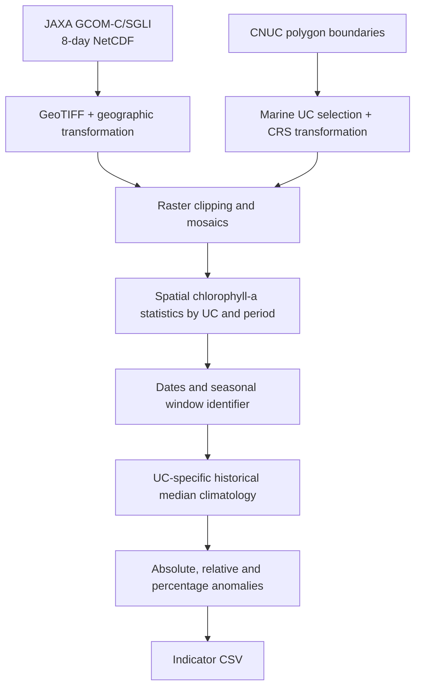

# Coastal Eutrophication Monitoring in Brazil — SDG 14.1.1a

**Reproducible processing of JAXA GCOM-C/SGLI chlorophyll-a observations for Brazilian marine Conservation Units**

[](https://sdgs.un.org/goals/goal14)
[](https://jupyter.org/)
[](https://zenodo.org/uploads/24212700)

> **Dataset status:** The linked Zenodo record is a *draft upload*, not a publicly citable DOI. Replace the draft link with the published record and DOI once released.
>
> **Reproducibility status:** The v2 notebook implements satellite acquisition, geospatial processing, spatial chlorophyll-a statistics, seasonal climatology, and anomaly calculations. Independent in situ validation and deployment are not yet implemented.

## Overview

This repository contains Python/Jupyter workflows for processing satellite-derived chlorophyll-a (Chl-a) concentrations over Brazilian coastal and marine Conservation Units (*Unidades de Conservação*, UCs) listed in the National Registry of Conservation Units (*Cadastro Nacional de Unidades de Conservação*, CNUC). The research supports methodological assessments related to **United Nations Sustainable Development Goal (SDG) Indicator 14.1.1a — Index of Coastal Eutrophication**.

The source observations come from the **Second-generation Global Imager (SGLI)** aboard the **Global Change Observation Mission–Climate (GCOM-C)** satellite operated by the **Japan Aerospace Exploration Agency (JAXA)**. The workflow processes Level-3, approximately **5 km**, **8-day** chlorophyll-a composites and associates observations with marine protected-area boundaries.

The analysis is organized around the **CRISP-DM** data-science lifecycle. The resulting measurements and anomalies are **research products**; they are not a complete or officially reported calculation of the UN SDG 14.1.1a indicator.

## Project links

- **Source repository:** https://github.com/joaotaff/eutrofizacao-bigdata
- **Zenodo draft dataset:** https://zenodo.org/uploads/24212700 *(may require owner access)*
- **Data Management Plan:** https://dmptool.org/plans/160408
- **Official UN indicator metadata:** https://unstats.un.org/sdgs/metadata/files/Metadata-14-01-01.pdf
- **CNUC geographic data portal:** https://cnuc.mma.gov.br/map

## Repository contents

The structure below reflects the GitHub repository inspected in November 2026. The v2 notebook supplied for this documentation is intended to replace/update the existing processing notebook in `source/`.

```text
eutrofizacao-bigdata/
├── README.md
├── source/
│   ├── ods14-1-1-a.ipynb             # Replace/update with the v2 processing notebook
│   └── dashboard/
│       └── Visualização1.twb         # Tableau workbook
├── quest3.ipynb                      # Exploratory analysis and UC comparisons
├── data/
│   ├── cnuc/
│   │   ├── ucs4326.shp              # CNUC shapefile; accompanying .dbf/.shx/.prj/.cpg
│   │   └── ...
│   └── eutrofization/
│       └── ods1411a_estatisticas_ucs_indicador.xlsx
├── unidades_conservacao.xlsx
├── Tarefa de Visualização de Dados.pbix  # Power BI file
└── documentation/
    └── esqueleto_pano_gestao_de_dados.pdf
```

**Important distinction:** The workbook currently in `data/eutrofization/` is a repository artifact. The v2 notebook itself exports the processed indicator as a **semicolon-delimited CSV**, not as an Excel workbook. The README does not assume that converting that CSV to XLSX is automated.

## Data sources and coverage

| Element | Description |
|---|---|
| Satellite / sensor | JAXA GCOM-C / SGLI |
| Input product | Level-3 chlorophyll-a concentration composites (`CHLA`, e.g. `CHLA_AVE`) |
| Approximate native product resolution | 5 km |
| Temporal sampling | 8-day composites |
| Study period | 2018–2026, depending on available input products |
| Geographic selection | Brazilian CNUC Conservation Units with a marine component |
| Geospatial reference | CNUC polygons, reprojected from SIRGAS 2000 (`EPSG:4674`) to WGS 84 (`EPSG:4326`) |
| Output concentration unit | mg/m³ |
| Main spatial identifier | `cd_cnuc` (retain as text) |

The dataset **does not represent spatially continuous coverage** of the Brazilian territorial sea or Exclusive Economic Zone. Its analysis units are selected marine Conservation Units.

## Processing workflow

The processing steps below are implemented in **`ods14-1-1-a-v2`** and should be executed in notebook order, after confirming local paths and external source availability.

1. **Acquire satellite observations:** Recursively download JAXA NetCDF products using anonymous FTP from `apollo.eorc.jaxa.jp`, directory `/pub/SGLI_STD/Global_05km/8-day/CHLA`.
2. **Convert and georeference rasters:** Extract satellite data from NetCDF, convert to GeoTIFF, and normalize the longitude convention to `EPSG:4326`. Preserve the scale, offset and no-data metadata.
3. **Acquire CNUC boundaries:** Download the CNUC geographic layer, decompress its shapefile, and reproject to `EPSG:4326`.
4. **Select marine UCs and spatially clip rasters:** Restrict features to the marine component and generate UC-related raster products.
5. **Build 8-day mosaics:** Group raster products by temporal window. The notebook defines a canonical mosaic grid in geographic coordinates for Brazil (`EPSG:4326`). Note that a mosaic/grid resampling setting is not necessarily the source sensor's native resolution.
6. **Extract spatial statistics:** Calculate the mean, median, minimum, maximum and valid-pixel count for each UC/raster observation; associate outputs with the CNUC metadata using `cd_cnuc`.
7. **Add dates:** Parse observation start dates from raster names and calculate inclusive eight-day end dates (start date + seven days).
8. **Compute climatology and anomalies:** Build a local seasonal climatology for every UC and eight-day window, and calculate absolute, relative and percentage anomalies.
9. **Export results:** Save a UTF-8-with-BOM, semicolon-delimited indicator CSV suitable for further analysis and publication.

### Workflow at a glance



## Requirements

- Python 3 and Jupyter Notebook/JupyterLab (the notebook metadata uses the `python3` kernel)
- Python packages: `numpy`, `pandas`, `requests`, `tqdm`, and GDAL Python bindings (`osgeo`)
- System installation of **GDAL**, including the command-line programs `gdalinfo` and `ogr2ogr`
- Network access to the JAXA FTP service and the CNUC download service
- Adequate disk space for multi-year NetCDF files and derived rasters

The notebook uses **Windows-style relative paths** in several cells. Adjust these paths when using Linux or macOS. Python package versions and a fully tested clean-environment build are **not yet pinned** in the repository.

### Example setup

```bash
git clone https://github.com/joaotaff/eutrofizacao-bigdata.git
cd eutrofizacao-bigdata
python -m venv .venv
```

On Windows:

```powershell
.venv\Scripts\Activate.ps1
```

On Linux/macOS:

```bash
source .venv/bin/activate
```

Install a GDAL distribution compatible with your platform and Python interpreter **before installing or importing `osgeo`**. Then install the other notebook dependencies:

```bash
python -m pip install jupyterlab numpy pandas requests tqdm
python -m jupyter lab
```

Open the **updated v2 processing notebook** in `source/` and run its cells in order. GDAL installation varies by operating system; a standard `pip install gdal` is not guaranteed to work unless compatible system libraries are already installed.

### Configuration to review before running

The processing notebook contains configuration cells for input and output directories, FTP connection details, shapefile locations, spatial bounds and file patterns. In particular, verify these default local paths:

```text
./downloads_jaxa/
./camada_vetorial_cnuc/
./raster_ucs/
./mosaicos_8dias/
./data/ods1411a_estatisticas_ucs.csv
./data/ods1411a_estatisticas_ucs_formatado.csv
./data/ods1411a_estatisticas_ucs_indicador.csv
```

These are **execution-time paths**, not all existing directories under Git version control. The download volume may be substantial. Consider replacing the notebook's hard-coded FTP login-email placeholder with an appropriate local configuration value before sharing or running it.

## Derived indicator methodology

The v2 notebook provides the climatology and anomaly calculation that was not in the earlier repository processing notebook.

For each Conservation Unit `u` (identified by `cd_cnuc`) and seasonal **8-day window** `t`, define:

- **Observed concentration:** `chl_observada` = `media`, the spatial mean of valid Chl-a pixels for the UC and period (mg/m³).
- **Seasonal window:** `janela_8d = floor((day_of_year - 1) / 8) + 1`.
- **Climatological reference:** `clim_uc_t` = historical **median** of `media`, grouped by (`cd_cnuc`, `janela_8d`) over **all available years in the input CSV**.
- **Sample count:** `n_obs_climatologia` = count of nonmissing `media` observations in the relevant UC-window group.

### Absolute anomaly

$$
A_{u,t} = C_{u,t} - \overline{C}_{u,t}
$$

where `anomalia` is expressed in **mg/m³**.

### Relative anomaly

$$
A^{rel}_{u,t} = \frac{C_{u,t} - \overline{C}_{u,t}}{\overline{C}_{u,t}}
$$

The result (`anomalia_relativa`) is dimensionless. The notebook produces `NaN` when the climatological denominator is zero or missing.

### Percentage anomaly

$$
A^{\%}_{u,t} = 100\, A^{rel}_{u,t}
$$

The result is stored in **`anomalia_relativa_pct`**, in percent (%). Positive results indicate concentrations above the local historical reference, while negative results indicate concentrations below it.

**Interpretation notes:** The climatological reference is **not** based on the fixed 2000–2004 period described in the UN international method. Its value can change as new years are added to the dataset. The `janela_8d` calculation is based on the raw day-of-year number; leap years and observations on seasonal boundaries deserve special consideration in cross-year comparisons. These simple UC-level anomalies are **not equivalent** to the UN's officially computed coastal-eutrophication deviation metric.

## Key output fields

| Field | Meaning | Unit |
|---|---|---|
| `cd_cnuc` | Official Conservation Unit identifier | text |
| `nome_uc` | Conservation Unit name | text |
| `marinho` | Marine component of the UC | ha |
| `raster` | Source satellite raster identifier | text |
| `ano` | Observation year | year |
| `scale`, `offset`, `nodata` | Source raster metadata | product-specific |
| `n_pixels_validos` | Valid pixels contributing to spatial statistics | count |
| `media`, `mediana`, `minimo`, `maximo` | Spatial Chl-a descriptive statistics | mg/m³ |
| `data_inicio`, `data_fim` | 8-day composite bounds | ISO date |
| `dia_do_ano` | Day of year derived from `data_inicio` | integer |
| `janela_8d` | Seasonal 8-day index within the year | integer |
| `chl_observada` | Chl-a observation adopted for anomaly calculations (`media`) | mg/m³ |
| `clim_uc_t` | UC- and window-specific historical median of `media` | mg/m³ |
| `anomalia` | Observed concentration minus climatology | mg/m³ |
| `anomalia_relativa` | Anomaly divided by climatology | ratio |
| `anomalia_relativa_pct` | Relative anomaly × 100 | % |
| `n_obs_climatologia` | Valid historical observations used for climatology | count |

The output additionally retains CNUC legal, administrative, spatial and biome attributes. See the published dataset and its accompanying data dictionary for the full field definitions.

## Outputs and reuse

The v2 notebook writes these successive files:

```text
data/ods1411a_estatisticas_ucs.csv
data/ods1411a_estatisticas_ucs_formatado.csv
data/ods1411a_estatisticas_ucs_indicador.csv
```

All three are semicolon-delimited CSV files generated by the notebook. The repository currently also contains `data/eutrofization/ods1411a_estatisticas_ucs_indicador.xlsx` for distribution and analysis. Any Excel export, manual renaming or other post-processing should be documented separately if it is used in a published release.

The companion `quest3.ipynb` performs exploratory comparisons of UCs, including visualizations and summary relationships. Tableau and Power BI files provide additional visualization artifacts, but they are not required to calculate the core CSV.

## Limitations and reproducibility checklist

- **Not an official SDG indicator calculation.** The pipeline provides chlorophyll-a statistics and UC-specific anomalies, not the full UNEP/UN computation or the riverine-nutrient ICEP component.
- **Validation pending.** The v2 notebook explicitly marks comparisons with independent in situ measurements and accuracy assessment as future work. No quantitative validation claim is made here.
- **Deployment pending.** The notebook's deployment section is a placeholder.
- **Final notebook cleanup required.** The closing CRISP-DM text in v2 still refers to an unrelated municipality/KNN example. This does not describe the coastal chlorophyll-a processing workflow and should be revised before software release.
- **Environment not frozen.** Record tested Python and GDAL versions, provide dependency lock files, and use a tagged release to preserve a reproducible software snapshot.
- **External dependencies.** JAXA/CNUC endpoints, product availability, and official UC geometries can change over time. Record download dates, dataset versions, checksums and processing parameters when publishing results.
- **Temporal detail.** Eight-day windows and leap-year handling should be tested explicitly. New years can change the climatological median.

## Contributors and academic context

The project originated in **Big Data Science (PCS-5787)**, a graduate-level course at the University of São Paulo (USP), taught by **Prof. Dr. Pedro Luiz Pizzigatti Corrêa** in 2026. The original project contributors named in the repository are:

- João Taff Freire
- Miguel Suares
- Rodrigo Baptista de Barros

The associated dataset description documents collaboration with the SDG 14 technical team at the **Brazilian Institute of Geography and Statistics (IBGE)**. Academic affiliation and scientific collaboration do not imply that this repository publishes an official IBGE statistical indicator.

## Citation

**Dataset:** Cite the **published Zenodo record and its DOI** once available; do not use the private draft URL as a permanent citation.

**Code:** Cite the GitHub repository and, preferably, a specific release/commit. If GitHub–Zenodo archiving is enabled, cite the software-release DOI separately from the dataset DOI.

**Suggested description:**

> Freire, J. T., Suares, M., & de Barros, R. B. (2026). *Coastal Eutrophication Monitoring in Brazil: Python processing workflow supporting SDG 14.1.1a*. Source code. https://github.com/joaotaff/eutrofizacao-bigdata

*Confirm the intended contributor names, order and publication license before releasing a formal citation.*

## Methodological references

- United Nations Statistics Division. (2025). *SDG Indicator 14.1.1 Metadata*. https://unstats.un.org/sdgs/metadata/files/Metadata-14-01-01.pdf
- Bricker, S. B., Ferreira, J. G., & Simas, T. (2003). An integrated methodology for assessment of estuarine trophic status. *Ecological Modelling, 169*, 39–60. https://doi.org/10.1016/S0304-3800(03)00199-6
- Ishizaka, J., Yang, M., Fujii, N., Katano, T., Hori, M., Mine, T., Saitoh, K., & Murakami, H. (2022). Use of AERONET-OC for validation of SGLI/GCOM-C products in Ariake Sea, Japan. *Journal of Oceanography, 78*, 291–309. https://doi.org/10.1007/s10872-022-00642-9
- Luang-on, J., Siswanto, E., Ogata, K., Toratani, M., Buranapratheprat, A., Leenawarat, D., & Ishizaka, J. (2024). Enhancing the reliability of GCOM-C/SGLI data for red tide detection in the upper Gulf of Thailand. *Remote Sensing Letters, 15*(10), 1096–1106. https://doi.org/10.1080/2150704X.2024.2406032

## Data management and licensing

The associated [Data Management Plan](https://dmptool.org/plans/160408) describes the data management framework. Before redistribution, verify the licensing and attribution requirements for the **code**, **JAXA source observations**, **CNUC boundaries**, and **derived dataset** independently. The repository did not show a standalone license file when inspected; no license is assumed by this README.
